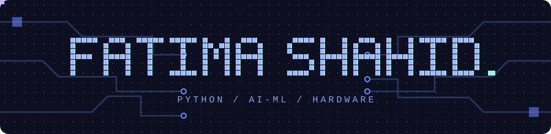

 

  

<table align="center">
<tr>
<td width="190" align="center">
  
</td>
<td>

**Backend systems, AI, and hardware.**  
Karachi, Pakistan.

  &nbsp;&nbsp;
  &nbsp;&nbsp;
  &nbsp;&nbsp;
  &nbsp;&nbsp;
  &nbsp;&nbsp;
  

</td>
</tr>
</table>

<h2 align="center">ABOUT ME</h2>

🎓 Computer and Information Systems Engineering Undergraduate  
🐍 Backend Developer working primarily with Python  
🤖 Interested in AI, Machine Learning, Microservices, and Backend Engineering  
💻 Passionate about problem-solving and algorithmic thinking  
✨ Exploring the intersection of software and hardware through practical projects  

<h2 align="center">TECH STACK</h2>

## Backend & Web Development

  
  
  
  
  
  
  

## Databases & Caching

  
  
  
  

## AI / Machine Learning

  
  
  
  
  

## FPGA & Digital Design

  
  
  
  
  

  
  
  
  
  

## Embedded Systems

  
  

### Tools & Development Environment

  
  
  
  
  
  
  

<h2 align="center">CORE EXPERTISE</h2>

  
  &nbsp;&nbsp;
  
  &nbsp;&nbsp;
  
  &nbsp;&nbsp;
  
  &nbsp;&nbsp;
  

  <b>Python &nbsp;|&nbsp; DSA &nbsp;|&nbsp; Embedded Systems &nbsp;|&nbsp; AI Engineering &nbsp;|&nbsp; FPGA &amp; Digital Design</b>

<h2 align="center">PROBLEM SOLVING</h2>

  
  &nbsp;&nbsp;&nbsp;&nbsp;
  

  <b>500+ problems solved.</b> Countless approaches explored. Always one more problem to understand.

<h2 align="center">ACHIEVEMENTS</h2>

🥇 First Place, NED Essay Writing Competition  
💻 500+ LeetCode problems solved (Python + SQL)  
🥈 Silver Level in SQL on HackerRank  
🏁 Competed in ProBattle, Calico, MIT, TeknoFest, SMEC and SuperComp  
✍️ 10+ articles published on Medium  
🧩 CS50 Puzzle Day: 10/10  
🛰️ Built a CanSat at Space Camp 2025  

<h2 align="center">BEYOND CODE</h2>

  <i>Not everything I create runs on code.</i>

<table align="center">
<tr>
<td width="100" align="center">
  
</td>
<td>
  PHOTOGRAPHY — Freezing the in-between.

  Finding stories in ordinary moments, playing with light, and capturing perspectives that deserve a second look.

  <a href="https://www.instagram.com/fatimas_abstract">Explore my visual stories ↗</a>
</td>
</tr>
<tr>
<td width="100" align="center">
  
</td>
<td>
  TECHNICAL WRITING — Making complex things click.

  Turning technical explorations, lessons, and ideas into words that make knowledge easier to understand.

  <a href="https://medium.com/@fatimashahid781">Read my writing ↗</a>
</td>
</tr>
<tr>
<td width="100" align="center">
  ✒️
</td>
<td>
  CALLIGRAPHY — Where patience becomes art.

  Finding rhythm in every stroke, beauty in every curve, and meaning in the spaces between letters.
</td>
</tr>
</table>

  <i>Different mediums. Different expressions. One curious mind.</i>

<h2 align="center">GITHUB STATS</h2>

<h2 align="center">LEETCODE</h2>

  

<h2 align="center">CONNECT WITH ME</h2>

  &nbsp;&nbsp;&nbsp;
  &nbsp;&nbsp;&nbsp;
  &nbsp;&nbsp;&nbsp;
  &nbsp;&nbsp;&nbsp;
  &nbsp;&nbsp;&nbsp;
  &nbsp;&nbsp;&nbsp;
  

<table align="center">
<tr>
<td width="150" align="center">
  
</td>
<td align="center">
  <h2>Let's create something impactful together!</h2>
  <i>Building, learning, and making ideas happen — one project at a time.</i>
</td>
</tr>
</table>
